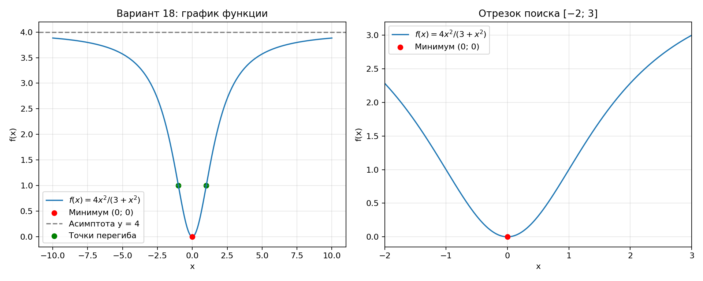
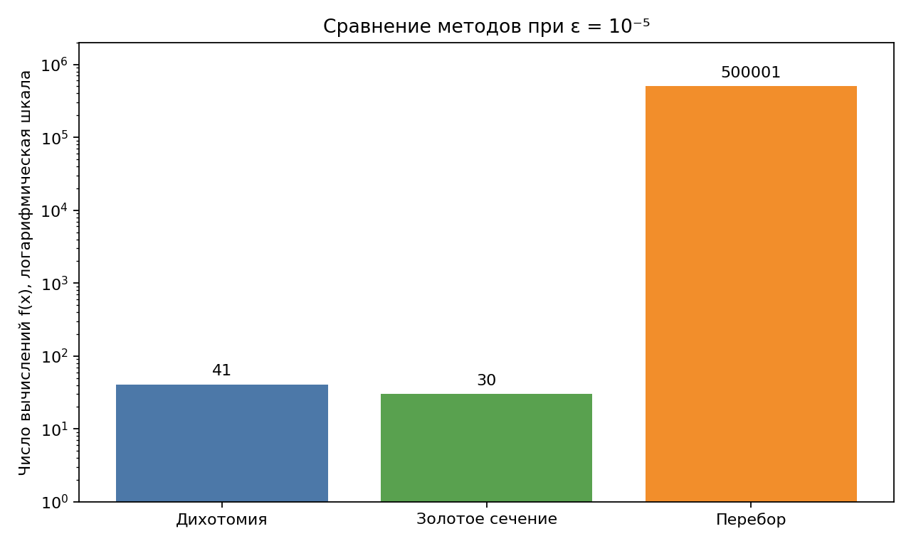

# Лабораторная работа №1. Методы одномерной оптимизации

**Вариант 18**

$$f(x)=\frac{4x^2}{3+x^2}.$$

Цель работы: аналитически найти экстремумы функции, построить график, выбрать отрезок поиска и сравнить численное решение методами дихотомии, золотого сечения и перебора.

## 1. Аналитическое решение

### Область определения, симметрия и значения

Поскольку $3+x^2>0$ при любом действительном $x$, область определения — $\mathbb R$. Функция чётная: $f(-x)=f(x)$. График симметричен относительно оси $Oy$.

$$f(x)=4-\frac{12}{3+x^2},\qquad 0\leq f(x)<4.$$

Единственный нуль функции — $x=0$. Во всех остальных точках функция положительна. Множество значений: $[0;4)$.

### Производная и экстремумы

По правилу дифференцирования частного:

$$f'(x)=\frac{8x(3+x^2)-4x^2\cdot2x}{(3+x^2)^2}
=\frac{24x}{(3+x^2)^2}.$$

Знаменатель положителен, поэтому знак производной совпадает со знаком $x$:

| x | $(−\infty;0)$ | $0$ | $(0;+\infty)$ |
|---|---|---|---|
| Знак $f'(x)$ | − | 0 | + |
| Поведение $f(x)$ | Убывает | Минимум | Возрастает |

Уравнение $f'(x)=0$ имеет единственный корень $x=0$. Производная меняет знак с минуса на плюс, следовательно,

$$\boxed{x^*=0,\qquad f(x^*)=0.}$$

Это строгий локальный и глобальный минимум. Дополнительная проверка: $f(x)\geq0$ для всех $x$, причём равенство достигается только при $x=0$. Локальных и глобального максимумов на $\mathbb R$ нет: верхняя грань $4$ не достигается.

### Вторая производная и асимптота

$$f''(x)=\frac{24(3+x^2)-96x^2}{(3+x^2)^3}
=\frac{72(1-x^2)}{(3+x^2)^3}.$$

При $|x|<1$ имеем $f''(x)>0$, при $|x|>1$ — $f''(x)<0$. В точках $x=\pm1$ знак второй производной меняется. Точки перегиба: $(-1;1)$ и $(1;1)$. Также $f''(0)=8/3>0$, что подтверждает минимум.

$$\lim_{x\to\pm\infty}f(x)=4.$$

Горизонтальная асимптота — $y=4$. Вертикальных асимптот нет.



## 2. Постановка численного поиска

Ищем минимум исходной функции $f(x)$ на $[a;b]=[-2;3]$. Этот отрезок содержит точку $x^*=0$ внутри. Функция непрерывна и унимодальна: строго убывает до минимума и строго возрастает после него. Поэтому методы сокращения интервала применимы.

Задаём $\varepsilon=10^{-5}$. Для интервальных методов останавливаемся при $b-a\leq\varepsilon$ и возвращаем середину: погрешность по аргументу не превосходит $\varepsilon/2$. Для перебора выбираем шаг $h\leq\varepsilon$. Для данной чётной функции, возрастающей с $|x|$, выбирается ближайший к нулю узел сетки, поэтому погрешность также не превосходит $h/2\leq\varepsilon/2$. Для произвольной унимодальной функции оценка ошибки выбора лучшего узла составляет $h$, а не обязательно $h/2$.

## 3. Алгоритмы

### Метод дихотомии

На каждой итерации вычисляем

$$x_1=\frac{a+b}{2}-\delta,\qquad x_2=\frac{a+b}{2}+\delta,
\qquad\delta=\varepsilon/10.$$

Если $f(x_1)\leq f(x_2)$, заменяем $b$ на $x_2$, иначе заменяем $a$ на $x_1$. Повторяем до достижения заданной длины отрезка. Условие $2\delta<\varepsilon$ позволяет достичь критерия останова. За итерацию выполняются два вычисления функции; ещё одно нужно для значения в итоговой середине.

### Метод золотого сечения

Пусть $\tau=(\sqrt5-1)/2\approx0.618034$. Выбираем

$$x_1=b-\tau(b-a),\qquad x_2=a+\tau(b-a).$$

Если $f(x_1)\leq f(x_2)$, оставляем $[a;x_2]$, иначе — $[x_1;b]$. Одна внутренняя точка и её значение сохраняются, а вторую вычисляем заново, если нужна следующая итерация. Длина отрезка каждый раз умножается на $\tau$.

В начале нужны два вычисления функции, затем одно на каждую следующую итерацию и одно в итоговой середине. При $k\geq1$ итерациях реализация использует $k+2$ вызова функции.

### Метод перебора

Разбиваем отрезок на

$$N=\left\lceil\frac{b-a}{\varepsilon}\right\rceil=500000$$

равных частей с шагом $h=(b-a)/N=10^{-5}$. Последовательно проверяем все $N+1$ узлов $x_i=a+ih$, включая оба конца. Возвращаем узел с наименьшим значением функции. Дополнительного уточнения и ограничения числа узлов нет: это обычный равномерный перебор.

Здесь $x_{200000}=0$, поэтому сетка точно попадает в минимум. Это свойство выбранной сетки и задачи, а не преимущество перебора по точности в общем случае.

## 4. Результаты вычислений

В таблице учитываются все фактические вызовы функции, включая вычисление значения в итоговой точке. У перебора «шаги» означают число переходов между узлами сетки; они не эквивалентны итерациям сокращения интервала. Основной показатель затрат — число вызовов функции.

| Метод | x̂ | f(x̂) | Итерации / шаги | Вызовы f | Ошибка по x | Длина / шаг |
|---|---:|---:|---:|---:|---:|---:|
| Дихотомия | 6.768369675e-07 | 6.108110408e-13 | 20 | 41 | 6.768369675e-07 | 6.768369675e-06 |
| Золотое сечение | 1.905449493e-06 | 4.840983696e-12 | 28 | 30 | 1.905449493e-06 | 7.035841986e-06 |
| Перебор | 0 | 0 | 500000 | 500001 | 0 | 1e-05 |

В последнем столбце указаны длина итогового отрезка для первых двух методов и шаг сетки для перебора. Ошибка по аргументу вычислена относительно аналитического решения $x^*=0$.



## 5. Сравнительный анализ и вывод

Все три метода нашли минимум с требуемой точностью и подтвердили аналитическое решение. Дихотомия потребовала 20 итераций и 41 вычисление функции. Золотое сечение потребовало больше итераций — 28, но меньше вычислений функции — 30, благодаря повторному использованию значений. Перебор потребовал 500001 вычисление: примерно в 16667 раз больше, чем золотое сечение.

Для фиксированного отрезка затраты перебора растут как $O(1/\varepsilon)$, а интервальных методов — как $O(\log(1/\varepsilon))$. Перебор прост, но при высокой точности требует значительно больше вычислений. Он не гарантирует нахождение узкого минимума произвольной функции между узлами без дополнительных предположений.

Для данной задачи золотое сечение наиболее экономно по числу вычислений функции. Более низкая фактическая ошибка дихотомии и точное попадание перебора в ноль относятся к выбранным параметрам и не означают общего превосходства этих методов по точности. Время выполнения не измерялось; вывод об эффективности основан на числе вызовов функции.

**Итог: единственный экстремум исходной функции — минимум $(0;0)$.**

## 6. Запуск программы

Программная реализация с пояснениями, графиками и результатами находится в [lab1.ipynb](lab1.ipynb). Откройте ноутбук в Jupyter или VS Code и выполните все ячейки сверху вниз (Run All).

Для установки зависимостей из корня репозитория:

```sh
python3 -m pip install -r optimization-methods/lab1/requirements.txt
```

В ноутбуке используются обычные функции и циклы, без классов. Результаты и графики выводятся прямо под ячейками.
